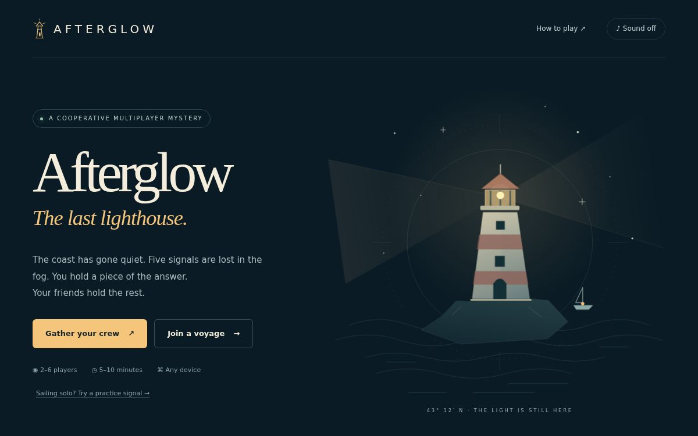

# Afterglow — The Last Lighthouse

A cooperative multiplayer deduction game by Gbenga Alabi, built with ChatGPT for Handshake's Create a Multiplayer Game mission.

**[Play the live game](https://afterglow-lighthouse.pastelperch4.chatgpt.site/)** · No account needed



Two to six players join a room from separate devices. Each player receives a private six-coordinate scanner clue. Exactly one coordinate appears in every clue. Players compare clues on an in-game radio, vote on a shared chart, and the keeper locks a unanimous choice. Four correct signals out of five restore the lighthouse; two misses end the watch. Choose 60, 90, or 150 seconds per signal.

No sign-in or installation. Invite by six-character room code or link. Rooms expire after 24 hours. A refreshed tab reconnects using a tab-local opaque pass. New tabs join separately. A labelled offline practice mode teaches the rules without requiring a second person.

## Implementation

The client uses native HTML, CSS, SVG and JavaScript, served by a dependency-free Cloudflare Worker. D1 stores room state. Clients poll every 1.2 seconds. Optimistic revision checks prevent concurrent votes and joins from overwriting one another. Private targets, other players' clues and crew passes are omitted from player responses. All player-generated text is escaped before rendering. Server time controls deadlines. Only the keeper can start, lock, and advance rounds. Room writes require an opaque crew pass.

## Run

Node 22.13 or newer (including `node:sqlite` for local verification):

```
node build.mjs
node test.mjs
node preview.mjs
```

Hosted publication uses Sites with the `DB` D1 binding and the tracked schema migration under `drizzle/`. Add your own Site's project ID to `.openai/hosting.json` before deploying a fork. Runtime has no third-party dependencies. Local preview uses an in-memory SQLite adapter and is for testing; production uses hosted D1.

## Verification and limitations

The test suite covers 500 generated puzzles across two to six players, unique solution intersections, clue and token privacy, authorization, stale-round rejection, scoring, timeouts, room creation/joining, concurrent votes, consensus, radio messages and next-round transitions. Live browser QA also verified two separate sessions joining one room, receiving different clues, sharing a clue, voting together, and restoring a beacon.

The game needs a connection for live multiplayer. Polling gives approximate 1–2 second synchronization. A departing player remains in the crew; if they cannot return, create a new room. Players joining after a voyage starts must wait for a new room. Room codes protect discoverability, not confidentiality; use nicknames and keep personal information off the radio. No analytics, account collection, wagers, or purchases are implemented.
